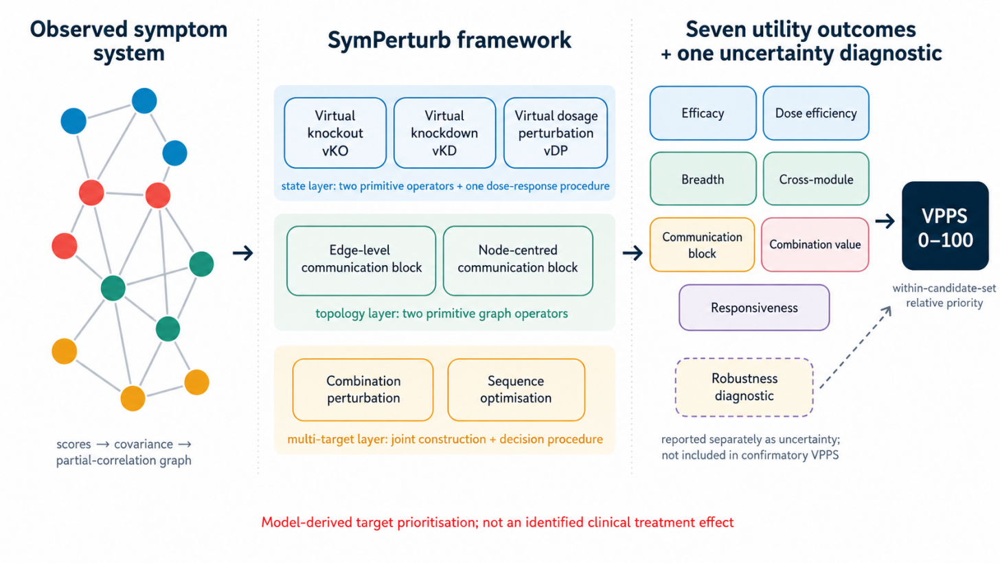

# SymPerturb

[**English**](README.md) | [简体中文](README_zh-CN.md)
**SymPerturb** converts a fitted cross-sectional symptom network into explicit, auditable **virtual perturbation target hypotheses**. It separates state perturbations, topology perturbations, multi-target procedures, seven utility outcomes, VPPS ranking, and uncertainty diagnostics.

> **Scientific boundary:** SymPerturb is not a causal `do()`-intervention estimator and does not establish clinical treatment efficacy. A cross-sectional undirected Gaussian graphical model supports model-based perturbation queries, not identified treatment effects.



## What is in this repository

This repository is designed for two uses:

1. **Agent Skill** — `.agents/skills/symperturb-analysis/` is a portable `SKILL.md` bundle following the Agent Skills structure used by OpenAI/Codex.
2. **Reference analysis package** — `src/symperturb/` provides a Python implementation of the revised seven-utility SymPerturb specification described in the manuscript.

The current manuscript, **SymPerturb: a virtual-perturbation framework for ranking intervention targets in symptom networks**, uses **seven utility dimensions + a separate robustness diagnostic**. It identifies package version `0.1.0` at commit [`76dd417`](https://github.com/zfrory15-max/SymPerturb/commit/76dd4178b285b80beb69f14a642e84ed1cabc7a0). The earlier eight-component/regeneration notice described a superseded draft, not the current manuscript.

**Reproducibility status:** this repository contains the reference package and smoke-test inputs. The manuscript-specific simulation driver, full generating parameters, and result-to-table/figure mapping have not been located in this repository. A package-version match and passing tests are **not** verification of the paper's numerical results. See [the reproducibility status and completion checklist](docs/REPRODUCIBILITY.md).

## Implemented methodology

The package implements:

- Gaussian covariance model with diagonal ridge regularisation and thresholded partial-correlation adjacency;
- general symptom-specific anchor + location-scale state intervention;
- virtual knockout (vKO) and virtual knockdown (vKD);
- virtual dosage perturbation (vDP);
- edge-level and node-centred communication blocking;
- bounded/winsorised-normal expected symptom means;
- combination perturbation with common outcome sets and signed incremental pair values;
- decision-objective sequence optimisation;
- seven utilities: efficacy, dose efficiency, breadth, cross-module reach, communication block, combination value, responsiveness;
- seven-dimension VPPS with within-candidate-set min-max normalization;
- robustness reported separately across the 13 reference sensitivity scenarios;
- complete-pipeline nonparametric bootstrap summaries;
- auditable CSV/JSON/Markdown/PNG outputs.

## Install

```bash
python -m venv .venv
source .venv/bin/activate   # Windows: .venv\\Scripts\\activate
pip install -e .
```

For tests:

```bash
pip install -e ".[dev]"
pytest
```

## Run the included example

```bash
symperturb \
  --data examples/synthetic_symptoms.csv \
  --modules examples/modules.csv \
  --anchors examples/anchors.csv \
  --config examples/config.yaml \
  --out example-output
```

The included dataset is a **repository smoke-test dataset**, not the manuscript simulation dataset and not patient data. The command above generates demonstration outputs in `example-output/`; these outputs are not committed. The 25 bootstrap replicates in `examples/config.yaml` are a smoke-test setting, not a publication-level uncertainty analysis.

## Run on your own data

Minimum files:

- symptom matrix: one row per participant, one numeric column per symptom;
- module map: `symptom,module`.

Recommended files:

- `anchors.csv`: `symptom,anchor`;
- `weights.csv`: `symptom,weight`;
- YAML config defining scale bounds, state map, thresholds, topology settings, combination rule, bootstrap count, and optional sequence objective.

See `docs/METHODS.md` and `.agents/skills/symperturb-analysis/references/input-output-contract.md`.

## Main outputs

`target_scores.csv` should be treated as the primary target-level table. It contains all seven raw utilities, their normalized 0-100 values, VPPS, rank, direct target benefit, beneficial downstream spillover, and adverse downstream spillover. Robustness and bootstrap summaries are separate by design.

## Exact knockout warning

An exact vKO with zero residual target variance creates a constant target. Do **not** standardize that target or re-estimate a full covariance matrix while retaining it. If a post-knockout network is scientifically required, prespecify an induced network with the target removed, a topology-only edge deletion, or a soft vKO and state the estimand.

## Reproducibility status

The package implements the seven-utility rule and keeps robustness outside VPPS. It remains a **reference implementation**, not a complete manuscript-reproduction archive. The current manuscript reports a 22-node, four-module verification study with continuous and ordinal measurements; those reported results have not been independently reproduced from the files in this repository.

The next required artifact is the authors' exact simulation driver and its parameters, seeds, environment, and outputs—not a newly invented replacement analysis. See [source/version provenance](docs/SOURCE_AND_VERSION.md), [reproducibility requirements](docs/REPRODUCIBILITY.md), and the [release checklist](docs/GITHUB_RELEASE_CHECKLIST.md).

## Citation

See `CITATION.cff`. Until a DOI/version of the manuscript is available, cite the manuscript title and this repository version.

## License

This repository is public, but its existing `LICENSE` does **not** grant a redistribution, modification, or commercial-use license. Public visibility is not an open-source license. Any license change requires the copyright holders' choice; this documentation update does not change the license.

